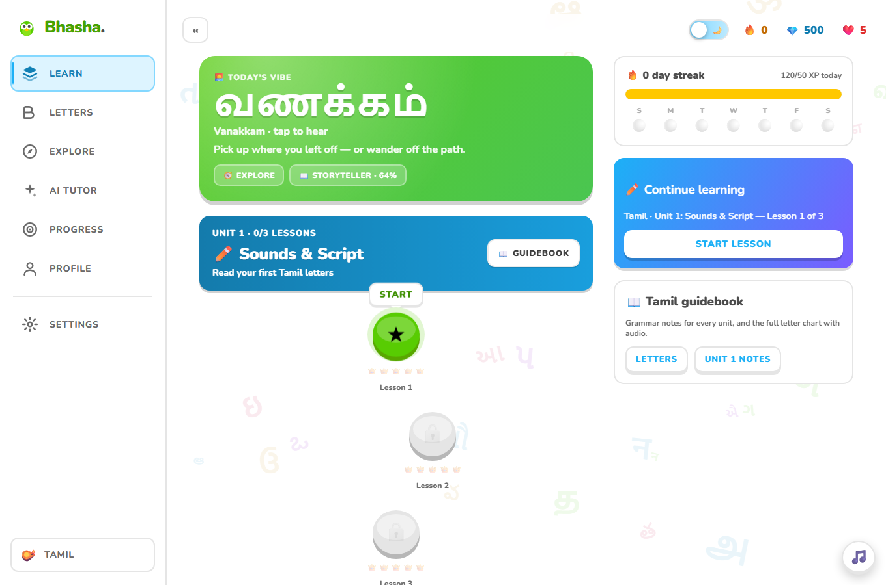
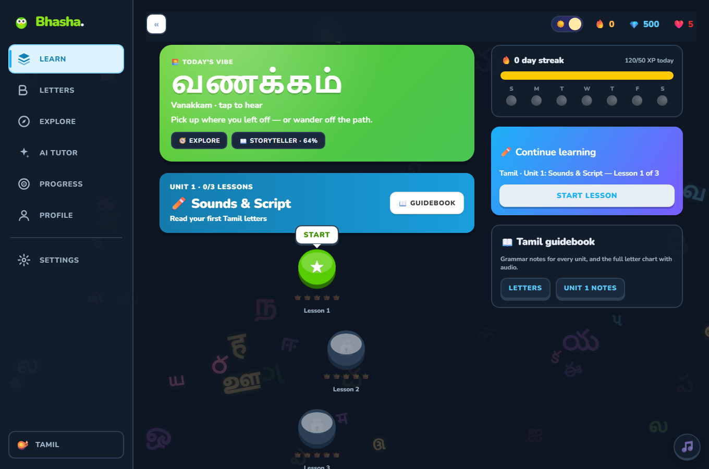
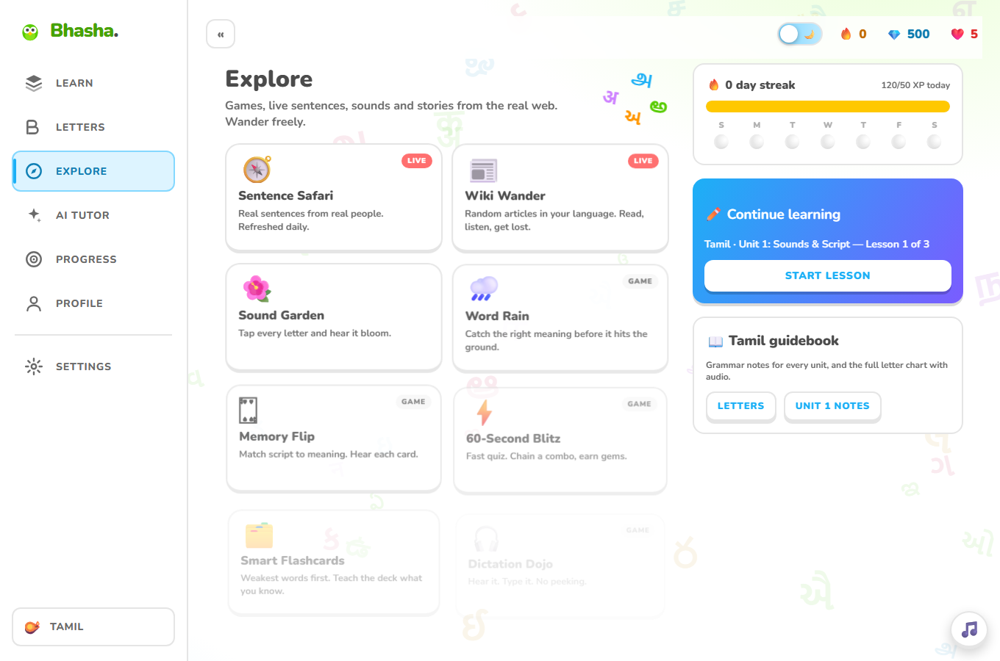
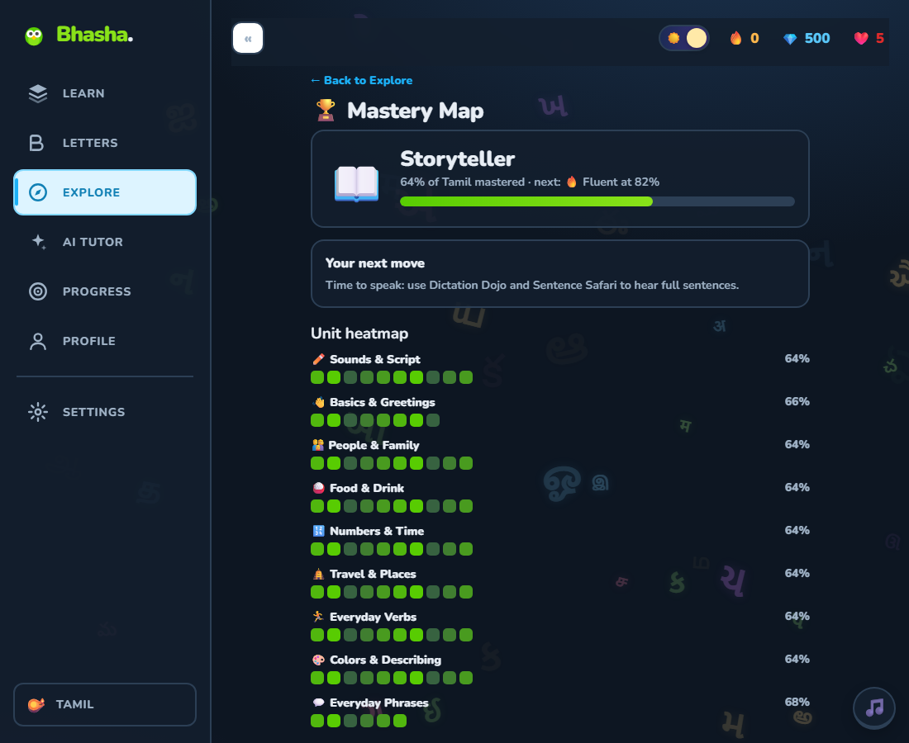
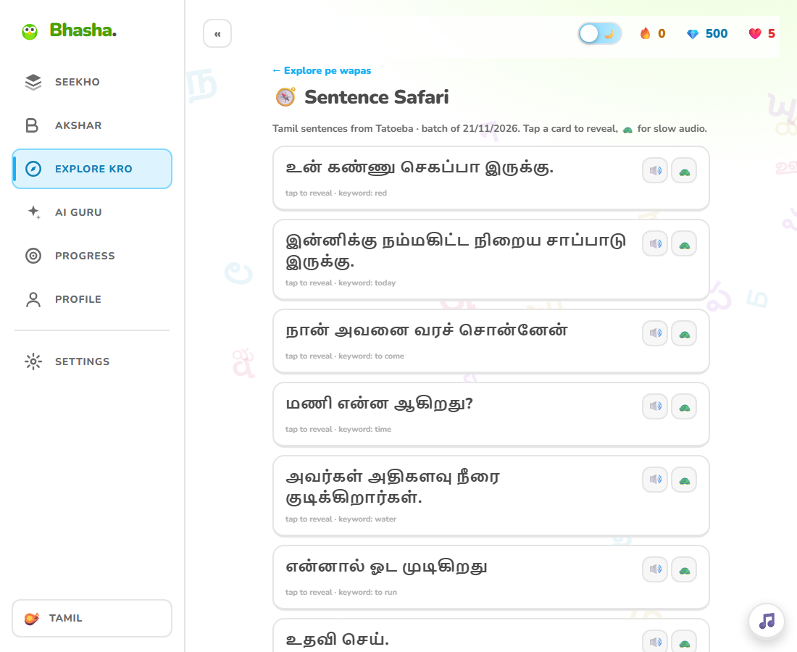
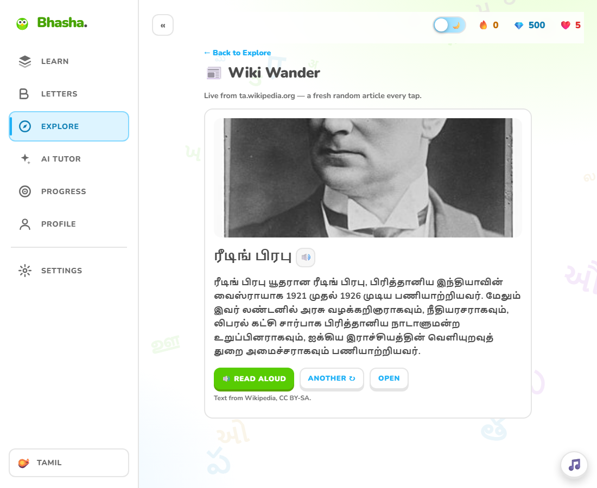
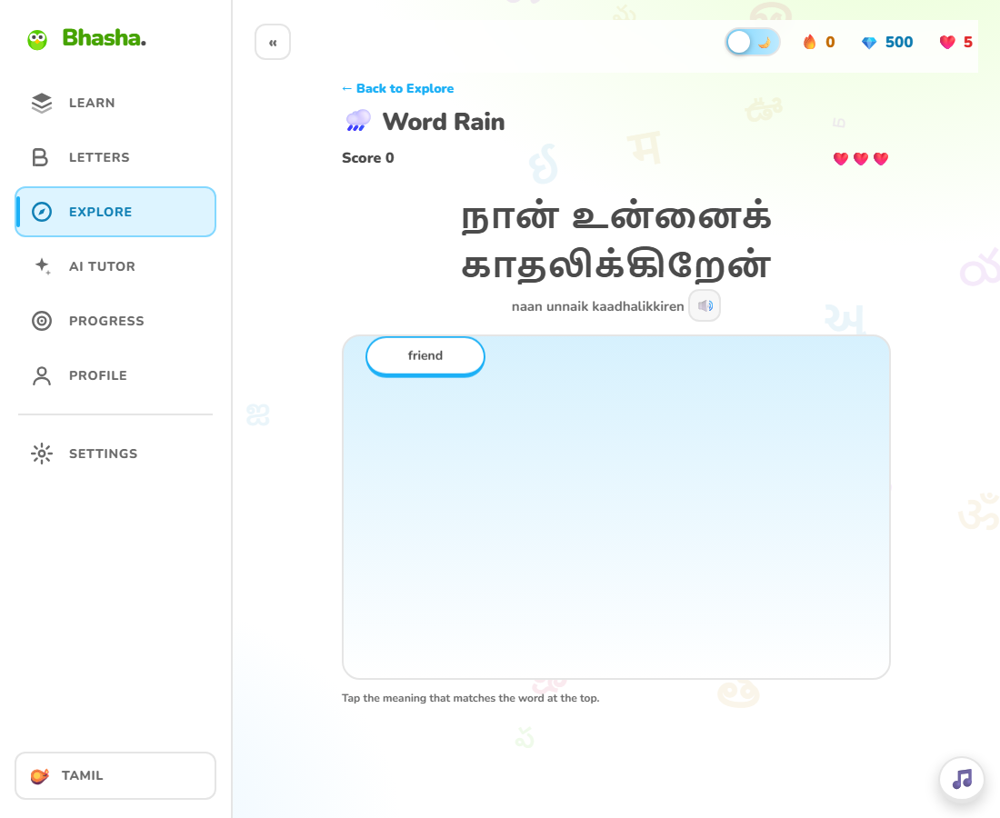
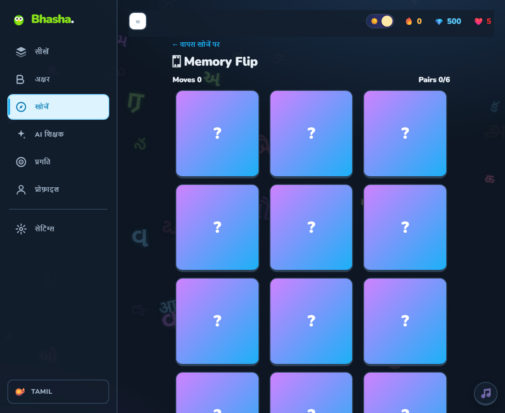
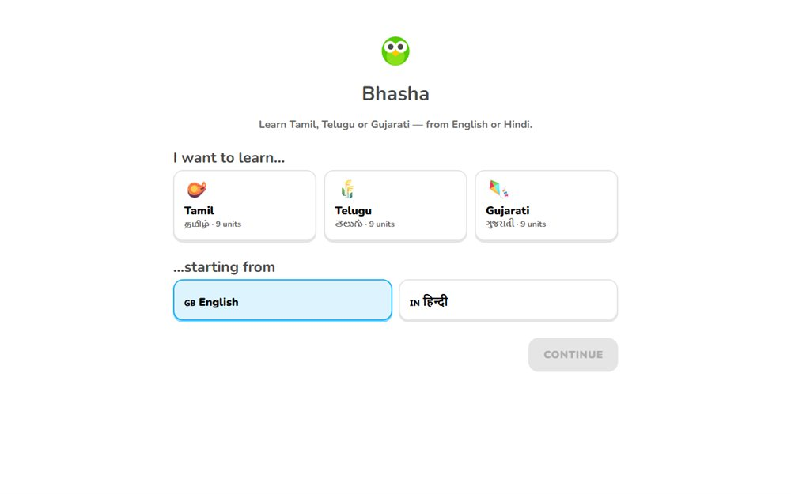
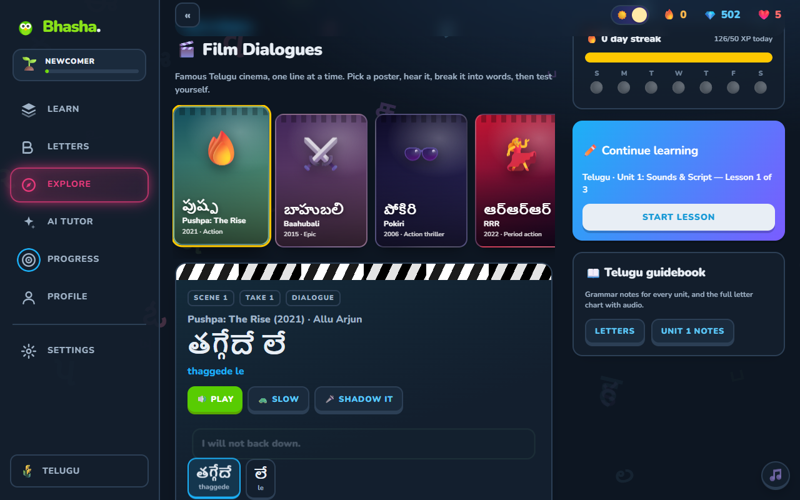

# Bhasha — learn Tamil, Telugu & Gujarati

<<<<<<< HEAD
**Live site:** https://ajeet-iitk.github.io/duo1/ *(GitHub Pages — enable it under Settings → Pages → `main` / root if the link 404s)*



| Night mode | Explore hub | Mastery map |
|---|---|---|
|  |  |  |

| Sentence Safari (live) | Wiki Wander (live) | Word Rain | Memory Flip (Hindi UI) |
|---|---|---|---|
|  |  |  |  |
=======
**[Open the live site](https://ajeet-iitk.github.io/duo1/)**


>>>>>>> 75355122180902cdcb979559bb0665e1621c5258


A Duolingo-style web app for learning **Tamil**, **Telugu** and **Gujarati** — from either
**English** or **Hindi**. Built as a plain static site: no build step, no dependencies,
no server required.

```
bhasha/
├─ index.html
└─ assets/
   ├─ css/styles.css
   └─ js/
      ├─ data/curriculum.js   ← all vocabulary, phrases, grammar notes, letter charts
      ├─ sfx.js               ← synthesised sound effects (Web Audio, no files)
      ├─ music.js             ← generative background music + controller
      ├─ theme.js             ← day/night, glyph background, favicon
      ├─ i18n.js              ← English / Hindi / Hinglish UI strings
      ├─ explore.js           ← Explore hub, live data, games, mastery map
      ├─ speech.js            ← text-to-speech + pronunciation scoring
      ├─ store.js             ← progress, streaks, hearts, gems, quests, achievements
      ├─ ai.js                ← the AI explainer + AI tutor
      ├─ exercises.js         ← curriculum → lesson questions
      ├─ lesson.js            ← the lesson player
      ├─ views.js             ← every screen + navigation chrome
      └─ app.js               ← bootstrap
```

## What's new in v5

- **E / हिन्दी / Hinglish** — pick the language you learn *from*; the whole UI, glosses and AI tutor follow it. Hinglish glosses are transliterated live from the Hindi data (`paani`, `dhanyavaad`) and the UI speaks gen-z.
- **Day / Night mode** — a sun/moon switch in the top bar (or Settings → Auto), with a smooth cross-fade, a night sky of glowing glyphs and a favicon that changes with the theme.
- **Living background** — Tamil, Telugu, Gujarati and Devanagari letters drift upward and scatter away from your cursor. Respects *reduced motion*.
- **Background music** — a floating controller (bottom-right) plays *generative* music synthesised in your browser: Raga Dawn, Lofi Chai, Monsoon, Temple Bells. Play/pause, mood, volume and a live visualiser; remembered between visits.
- **Explore** — ten things to wander into: **Sentence Safari**, **Wiki Wander**, **Lookup Lab** (live), **Sound Garden**, **Word Rain**, **Memory Flip**, **60-Second Blitz**, **Dictation Dojo**, **Smart Flashcards**, and the **Mastery Map** (levels Newcomer → Master with a per-word heatmap and a "next move" coach). Every game feeds word-strength, XP and gems.
- **Better audio** — ranks the best installed voice (Natural/Google/Microsoft first), lets you pick one in Settings, adds 🐢 slow playback, and falls back to a free online voice when your device has no Tamil/Telugu/Gujarati voice.
- **Creative navbar** — a glowing pill that slides between tabs (each tab has its own colour), a live mastery-level chip under the logo, a daily-goal ring around Progress, a compass that wiggles on Explore, and a floating glass dock on phones.
- **Cinematic day/night** — switching themes takes ~2.4 s: the new theme is revealed through a circle expanding from the toggle while a sun or moon crosses the sky with a dusk/dawn wash and twinkling stars.
- **Film Dialogues** — famous Tamil, Telugu and Gujarati film lines (Baasha, Nayakan, Pushpa, Pokiri, RRR, Hellaro, Last Film Show and more) on CSS-drawn posters. Hear each line, slow it down, tap words for meanings, shadow it with the mic, or take the cinema quiz.
- **Fixed:** progress was wiped on every page reload once you had earned XP (a state-loading crash); scrolling; night mode on lessons, popups and settings.



## Live content from free sources

No API keys anywhere.

| Source | Used for | How it stays fresh |
|---|---|---|
| [Tatoeba](https://tatoeba.org) (CC BY 2.0 FR) | Example sentences with translations | `tools/update-content.mjs` rebuilds `assets/js/data/live-cache.js`; the **Update live content** GitHub Action runs it daily. Lookup Lab also searches live via a CORS relay. |
| [Wikipedia REST API](https://www.mediawiki.org/wiki/API:REST_API) | Random articles in ta/te/gu (Wiki Wander) | fetched live in the browser |
| [Wiktionary API](https://www.mediawiki.org/wiki/API:Main_page) | Dictionary hits in Lookup Lab | fetched live |
| Google Translate TTS | Fallback voice | on demand |

Refresh the bundled sentences by hand any time: `node tools/update-content.mjs`.

**Screenshots / demo:** open `/?demo=en`, `?demo=hi` or `?demo=hg` for a pre-seeded profile, and add `&theme=dark` for night mode.

## Run it

Double-click `index.html`, or (recommended, so the browser can load everything reliably):

```bash
cd bhasha
python -m http.server 8765
# then open http://127.0.0.1:8765/
```

## What's in it

**Three full courses, two base languages each.** Every word carries an English gloss, a
Hindi gloss, the native script and a romanisation, so the same course works whether you
study from English or Hindi. Switch either at any time — progress is stored per language.

| | Tamil | Telugu | Gujarati |
|---|---|---|---|
| Units | 9 | 9 | 9 |
| Words & letters | 114 | 115 | 115 |
| Sentences | 17 | 17 | 17 |

(84 vocabulary items plus a 30–31 letter chart per language, and 17 full sentences.)

Each course opens with a **Sounds & Script** unit, then Greetings, Family, Food, Numbers
& Time, Travel, Verbs, Describing, and Everyday Phrases. Every unit ships with grammar
notes (the *Guidebook*) written for an English/Hindi speaker — vowel length in Tamil,
Hindi cognates in Gujarati, the dative `-కు / -க்கு` patterns, and so on.

**Six exercise types**, mixed automatically per lesson:

| Type | What it does |
|---|---|
| Multiple choice | recognise script ⇄ meaning, in both directions |
| Listening | hear the word (native TTS) and tap what you heard |
| Word bank | build a real sentence from shuffled tiles |
| Matching pairs | tap pairs to connect script to meaning |
| Typing | write the answer in script *or* romanisation, with a tile fallback |
| Speaking | microphone scoring via the Web Speech API, self-report where unsupported |

**Duolingo's UX, faithfully:** the left nav, the unit banner with Guidebook button, the
zig-zag path with a bobbing node and a START bubble, checkpoint trophies, the sticky top
bar with streak/gems/hearts, the big-rounded buttons with a 4px bottom edge that presses
down when tapped, the green/red lesson footer, hearts, combos, XP, crowns, the results
screen, daily quests, achievements and dark-green mascot commentary throughout.

### The retractable sidebar

The sidebar collapses to an **80px icon rail** — labels, the wordmark and the course name
disappear, leaving the icons with tooltips — which hands 176px straight back to the
content. Use the **« / »** button at the top-left, or Settings → **Layout**; the choice is
remembered. It matters most on 900–1140px laptops, where the right rail is already hidden
and the sidebar is otherwise a quarter of the screen. On phones the sidebar is replaced by
the bottom tab bar, so the toggle is hidden there.

When the right rail is hidden the central column is now centred rather than pinned left,
so no dead space is left beside it.

Only the parts that actually *do* something are kept. There is no fake paywall, no
simulated league table and no product page: gems are earned by learning and spent on the
two things that affect play — refilling hearts and buying a streak freeze — right from the
Progress page and the out-of-hearts dialog.

## Sound

All effects are **synthesised at runtime** with the Web Audio API — correct chime, combo
sparkle, wrong-note buzz, heart loss, lesson fanfare, crown level-up, streak flare, chest
open, coin, unlock, whoosh and a game-over descent. No audio files to ship, and every cue
is muted instantly from Settings.

Native audio uses the browser's speech synthesiser with `ta-IN`, `te-IN` and `gu-IN`
voices. If your device lacks them the app says so rather than faking it with a Hindi
voice reading Tamil script.

## The AI explainers

Every single question is explainable. A **💡 Explain** button sits in the lesson top bar
while you are answering, and reappears next to **Continue** / **Got it** once you have
answered — so the help is there whether you got it right or wrong, and *before* you
commit. The drawer shows the word (script, romanisation, meaning, tap-to-listen) plus the
exact question you are on, then explains it: for a matching exercise it explains every
pair at once, for a listening question it explains the sounds, for a typing question it
explains how the letters build the word, and so on.

There are **two engines behind that one button**, and the offline one is always available:

1. **Built-in explainer (default, no key needed).** Generated from the curriculum itself:
   syllable-by-syllable pronunciation, a letter-by-letter decomposition of the native
   script using the course alphabet, the unit's grammar rules, real example sentences that
   contain the word, sound-alike neighbours, and a memory hook. It also answers follow-up
   questions about word order, politeness levels, gender, the script and pronunciation.

2. **Any OpenAI-compatible model.** In **Settings → AI explainers**, set:

   | Field | Example |
   |---|---|
   | Provider | `OpenAI-compatible API` |
   | Endpoint | `https://api.openai.com/v1` |
   | API key | `sk-…` |
   | Model | `gpt-4o-mini` |

   Then hit **Test connection**. The key is stored only in this browser's `localStorage`
   and is sent directly to the endpoint you name — nothing proxied.

Once connected, the model takes over the explainer drawer, the wrong-answer diagnosis shown
automatically in the lesson footer, and the full **AI Tutor** chat.
If a call fails, the app falls back to the built-in explainer and tells you why.

You can also point it at a local model — Ollama, LM Studio, vLLM — by using its
OpenAI-compatible base URL, e.g. `http://localhost:11434/v1`.

## Progress & data

Everything lives in `localStorage` under `bhasha.state.v1`: per-language XP, crowns per
lesson, word strength, streak calendar, hearts (one regenerates every 30 minutes), gems,
daily quests, achievements and your AI settings. **Settings → Danger zone** wipes it.

## Adding your own content

`assets/js/data/curriculum.js` holds the whole syllabus. One unit looks like this:

```js
{
  id: 'ta-u3', title: 'Food & Drink', subtitle: 'Order what you actually want to eat',
  color: '#FF9600', icon: '🍚',
  notes: [{ title: '…', body: '…' }],          // shown in the Guidebook + AI explainer
  items: words('ta', [
    ['water', 'पानी', 'தண்ணீர்', 'thanneer'],   // en, hi, script, roman
  ]),
  phrases: phrases('ta', [
    ['I want water.', 'मुझे पानी चाहिए।', 'எனக்கு தண்ணீர் வேண்டும்.', 'enakku thanneer vendum.'],
  ])
}
```

Add a unit and the path, quests, exercise generator, guidebook and AI explainer all pick
it up automatically. Add a course by dropping another object into `COURSES`.

## Known limits

- Speech recognition quality depends on your browser; the app falls back to self-report so
  a speaking exercise can never block you.
- The AI explainer needs an API key for model-generated answers; the offline engine is
  written from the curriculum, so it is accurate but finite.
